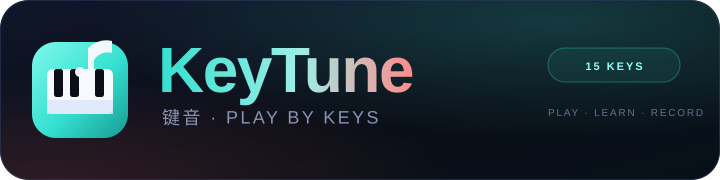

<p align="center">
  
</p>

# KeyTune · 键音

> 用手机按键学习音符、演奏旋律、挑战节奏，并记录自己的演奏。

KeyTune 是一个为手机横屏设计的轻量 H5 音乐小游戏。玩家在 15 键虚拟钢琴上跟随提示按键，系统用 PERFECT / GREAT / GOOD / MISS 判定，并用 Combo、得分和评级给出反馈。支持跟弹、节奏挑战、闯关、自由演奏、和弦识别、演奏记录回放、成就和每日挑战。

## 在线体验

部署到 Cloudflare Workers 后，访问 Worker 的 `workers.dev` 地址。

## 本地开发

```bash
npm install
npm run dev
```

打开终端输出的 Local 或 Network 地址。手机真机测试时，手机和电脑需要处于同一局域网，访问 `http://<电脑局域网 IP>:5173/`。

### iPhone 全屏

iPhone Safari 不能通过网页代码隐藏地址栏。请在 Safari 中：

1. 点击分享按钮
2. 选择“添加到主屏幕”
3. 从主屏幕打开 KeyTune

这样会以 PWA standalone 模式启动，隐藏 Safari 地址栏与工具栏。顶部工具栏的 `⛶` 按钮会给出同样的引导。

## 构建与检查

```bash
npm run typecheck
npm run build
npm run preview
```

## 部署到 Cloudflare Workers

```bash
npx wrangler login
npm run deploy
```

Worker 配置在 `wrangler.jsonc`，静态资源由 Workers Assets 提供，SPA fallback 到 `index.html`。

健康检查：

```text
GET /api/health
```

返回：

```json
{ "ok": true, "service": "keytune", "version": "0.1.0" }
```

## 技术栈

- Vite 8
- TypeScript 5.9（strict）
- Cloudflare Workers
- `@cloudflare/vite-plugin`
- Wrangler 4
- 原生 DOM / Canvas / Web Audio，无前端框架、无 UI 库

## 目录

```text
.
├── AGENTS.md                  # 开发约束与 Feature 工作流
├── assets/                    # 运行时静态资源（Vite publicDir）
│   ├── images/
│   ├── audio/
│   ├── manifest.json
│   └── site.webmanifest
├── design/source/images/      # 设计源图，不进入运行时
├── docs/
│   ├── requirement.md
│   ├── design-requirements.md
│   ├── features/
│   └── screenshots/
├── src/
│   ├── app.ts
│   ├── audio/
│   ├── keyboard/
│   ├── songs/
│   ├── game/
│   ├── recorder/
│   ├── achievements/
│   ├── levels/
│   ├── daily/
│   ├── storage/
│   ├── views/
│   └── styles.css
├── worker/index.ts
├── index.html
├── vite.config.ts
├── wrangler.jsonc
├── tsconfig.json
└── package.json
```

## 当前状态

- F00～F12：MVP 已完成
- F13：体验打磨与发布进行中
- 详细状态与验证记录：`docs/features/STATUS.md`
- 设计基准：`docs/design-requirements.md`

## 素材

- 9 张图片：应用图标、Logo、通用背景、6 张曲目封面
- 7 个短音效
- 15 个琴键音实时合成，不依赖音频采样
- 所有 UI、琴键、音符、判定、分享卡均由代码绘制

素材路径与 ID 映射见 `assets/manifest.json`。

## 约束

- 无账号、无登录、无上传
- 数据保存在本机
- 无 BGM、无曲目伴奏、无麦克风录音
- 目标设备：iPhone 16 Pro / Pro Max Safari 横屏
